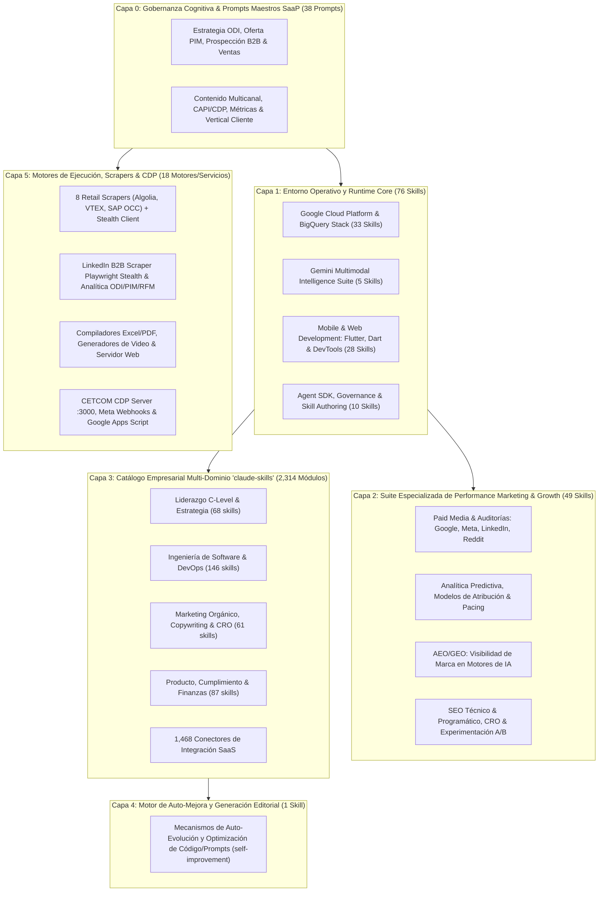

# Directorio Central de Capacidades del Sistema: Índice Máster de Skills & Recursos

> **Documento de Arquitectura de Sistemas**  
> **Autor:** Arquitecto de Sistemas de Inteligencia Artificial & Agentes Autónomos  
> **Fecha de Emisión:** Octubre 2026 | **Estado:** Aprobado para Operación (Ecosistema Unificado)  
> **Repositorio Base:** `c:\Users\Antonio Cardozo\Documents\01.- Projects\04- WF_Mark_Depart`  
> **Directorio Central de Skills:** `10. Tools/claude-skills`  
> **Directorio Central de Prompts Maestros:** `0. Referencia Estrategica/01.- Prompts_Maestros`  
> **Directorio Central de Ejecución & Scrapers:** `9. Project_Autonomous`  
> **Directorio Central de Ingesta Omnicanal:** `7. Customer_Data_Platform`

---

## 1. Visión y Marco Arquitectónico del Ecosistema

Este documento constituye el **Directorio Central de Capacidades (Capability Master Directory)** del entorno de agentes. Consolida de manera exhaustiva, estructurada y normalizada todas las habilidades (*skills*), directivas cognitivas (*Prompts Maestros*) y motores de ejecución (*scrapers, publishers, herramientas de analítica y APIs*) operativas e integradas en el sistema.

La arquitectura de capacidades se organiza siguiendo un **Modelo Estratificado de 6 Capas de Abstracción**, diseñado para garantizar la máxima coherencia operativa, desacoplamiento funcional, cero redundancia y eficiencia en la selección y ejecución de tareas:

### Resumen Cuantitativo de Capacidades (Ecosistema Integrado Completo)

| Nivel Arquitectónico | Fuente / Directorio Físico | Total Recursos | Propósito Principal |
| :--- | :--- | :--- | :--- |
| **Capa 0: Prompts Maestros Cognitivos** | `0. Referencia Estrategica/01.- Prompts_Maestros/` | **38 Prompts** | Marco cognitivo SaaP (Estrategia ODI, PIM, Outbound, Contenido, Ventas, CAPI, Operaciones y Vertical Vitaminas) |
| **Capa 1: Entorno Operativo** | Runtime Platform (Antigravity Core, DAK, Flutter, DevTools) | **76 Skills** | Infraestructura Cloud, Big Data, Modelos Gemini, Flutter/Dart y Gobernanza |
| **Capa 2: Marketing Especializado** | `10. Tools/claude-skills/marketing-performance/skills` | **49 Skills** | Performance Marketing, Paid Media, GEO/AEO, Analítica, Pacing y Atribución |
| **Capa 3: Catálogo Empresarial** | `10. Tools/claude-skills` (21 Módulos Especializados) | **2,314 Módulos** | Módulos C-Level, Ingeniería, Producto, Legal, Finanzas e Integraciones SaaS |
| **Capa 4: Automatización Editorial** | `10. Tools/Fábrica_Cont_Libros/.agents/skills` | **1 Skill** | Auto-mejora heurística y producción editorial algorítmica (`self-improvement`) |
| **Capa 5: Motores de Ejecución & CDP** | `9. Project_Autonomous/core/` & `7. Customer_Data_Platform` | **18 Motores/Servicios** | 8 Scrapers Retail, 1 LinkedIn Scraper, 3 Analítica, 2 Publishers, 2 Media, 1 Auditor CDP, 1 CDP Server |
| **Total de Capacidades Ecosistema** | **Directorio Maestro Unificado** | **2,496 Recursos** | **Ecosistema Integrado de Inteligencia, Estrategia y Ejecución** |

---

## 2. Capa 1: Directorio de Skills del Entorno Operativo (Runtime Core)

Habilidades nativas activas en la plataforma del agente y plugins del sistema. Proveen la base técnica para gestión de infraestructura cloud, manipulación distribuida de datos masivos, modelos multimodales Gemini, desarrollo multiplataforma Flutter/Dart, herramientas Chrome DevTools y salvaguardas de seguridad.

| Nombre de la Skill | Descripción Concisa de su Función | Casos de Uso Principales |
| :--- | :--- | :--- |
| `a11y-debugging` | Auditoría y depuración de accesibilidad (a11y) web basada en pautas web.dev usando Chrome DevTools MCP. | Validación de contraste de color, árbol semántico ARIA, navegación por teclado, focus states y etiquetas accesibles. |
| `accidental-data-loss-prevention` | Protocolo de salvaguarda que detiene operaciones destructivas irreversibles y exige confirmación explícita del usuario. | Prevención de DROP/TRUNCATE/DELETE masivo en SQL, eliminación de buckets críticos con gsutil rm, y borrado de recursos o proyectos GCP. |
| `agy-customizations` | Framework de arquitectura y configuración para el sistema de personalización de Google Antigravity (skills, rules, plugins, hooks y MCPs). | Creación, diagnóstico y orquestación de componentes personalizados, validación de prioridades de carga y descubrimiento de extensiones. |
| `antigravity-guide` | Manual y sitemap exhaustivo de referencia para la plataforma Antigravity (CLI agy, Antigravity 2.0, IDE, Python SDK y atajos). | Consultas arquitectónicas sobre la plataforma, configuración del entorno, uso de slash commands y depuración de sidecars. |
| `bigquery-ai-ml` | Capacidades nativas de Machine Learning y GenAI integradas directamente en el motor de BigQuery SQL. | Pronóstico de series temporales (ARIMA+), detección de anomalías en transacciones, identificación de key drivers y generación con LLMs en SQL. |
| `bigquery-bigframes` | API escalable de DataFrames de Python (BigFrames) ejecutada transparentemente sobre el motor distribuido de BigQuery. | Manipulación de terabytes en Python al estilo pandas/scikit-learn sin descargar datos a memoria local; pipelines analíticos y ML. |
| `bigquery-data-transfer-service` | Inspección, descubrimiento y auditoría de canalizaciones automatizadas de ingesta mediante BigQuery DTS. | Identificación de flujos de ingesta existentes desde Google Ads, YouTube, Amazon S3, Cloud Storage o Teradata hacia BigQuery. |
| `bigquery-graph-author` | Modelado e implementación de extremo a extremo de Grafos de Propiedades en BigQuery a partir de esquemas relacionales. | Diseño de ontologías, definición de nodos/aristas con DDL CREATE PROPERTY GRAPH y validación de relaciones de entidades complejas. |
| `bigquery-graph-query` | Motor de consultas avanzadas sobre grafos de propiedades y grafos semánticos usando el estándar GQL nativo y GRAPH_TABLE. | Análisis de rutas multirrebote, detección de fraude, redes de influencia, centralidad y consultas semánticas combinadas con embeddings. |
| `bigquery-sql` | Optimización avanzada, diseño de particionado/clustering y afinamiento de rendimiento para consultas SQL de gran escala. | Reducción de costos de consulta en BigQuery, optimización de uso de slots, eliminación de cuellos de botella y reescritura de joins. |
| `bigtable-basics` | Diseño de esquemas NoSQL de ultra baja latencia, definición de row keys y administración de clústeres en Google Cloud Bigtable. | Modelado de datos para series temporales masivas, prevención de hotspots en row keys, consultas operativas y afinamiento de familias de columnas. |
| `building-data-apps` | Construcción rápida de aplicaciones interactivas de datos y paneles de control modernos con React + Vite o Streamlit conectados a GCP. | Dashboards de analítica en tiempo real, interfaces interactivas de visualización de datos y aplicaciones de chat conversacional sobre datos. |
| `chrome-devtools` | Automatización, inspección y depuración profunda del navegador web mediante el protocolo Chrome DevTools sobre MCP. | Inspección de llamadas de red (XHR/Fetch), auditoría de Core Web Vitals, depuración de errores JavaScript y pruebas automatizadas de UI. |
| `dak-setup` | Configuración y diagnóstico del Data Agent Kit (DAK), validando credenciales ADC, proyectos GCP y servicios activos. | Puesta a punto inicial de conectividad de datos en GCP, resolución de errores de autenticación y reconfiguración de proyectos/regiones. |
| `dart-add-unit-test` | Diseño y organización de pruebas unitarias modulares para funciones, métodos y clases en Dart. | Desarrollo guiado por pruebas (TDD), prevención de regresiones de lógica de negocio y suites con package:test. |
| `dart-build-cli-app` | Arquitectura y desarrollo de herramientas de línea de comandos, parseo de argumentos y scripts multiplataforma en Dart. | Construcción de CLIs corporativas, gestión limpia de códigos de salida (exit codes) y utilidades de automatización. |
| `dart-collect-coverage` | Recolección de cobertura de código y generación de reportes de cobertura LCOV para proyectos Dart. | Medición de cobertura de pruebas unitarias, auditoría de ramas no ejecutadas y exportación de métricas para CI/CD. |
| `dart-fix-runtime-errors` | Diagnóstico y resolución ágil de errores en tiempo de ejecución analizando stack traces con LSP. | Localización exacta de fallos en ejecución, corrección de excepciones no controladas y validación mediante hot reload. |
| `dart-generate-test-mocks` | Generación automatizada de objetos simulados (mocks) para pruebas unitarias de dependencias complejas. | Simulación de servicios externos, APIs REST y bases de datos usando package:mockito y build_runner. |
| `dart-migrate-to-checks-package` | Modernización de aserciones de pruebas migrando de la librería tradicional expect() a package:checks. | Refactorización a aserciones más legibles, descriptivas y con mensajes de fallo semánticamente claros. |
| `dart-resolve-package-conflicts` | Resolución metodológica de discrepancias y colisiones de versiones de dependencias en proyectos Dart. | Diagnóstico de bloqueos en pub get, resolución de restricciones de versiones incompatibles y actualización controlada. |
| `dart-run-static-analysis` | Ejecución rigurosa de análisis estático de código Dart y resolución automática de advertencias de linter. | Garantía de calidad de código antes de commits con dart analyze y aplicación mecánica de correcciones con dart fix. |
| `dart-setup-ffi-assets` | Compilación y empaquetado de librerías nativas C/C++ vinculadas mediante Native Assets hooks. | Integración de librerías C/C++ de alto rendimiento en Dart/Flutter sin configuraciones manuales complejas de toolchain. |
| `dart-use-ffigen` | Generación automatizada de bindings Dart FFI a partir de archivos de cabecera de C/Objective-C/Swift. | Eliminación de bindings manuales propensos a error mediante bindings generados de forma determinista con package:ffigen. |
| `dart-use-pattern-matching` | Adopción de switch expressions exhaustivas y pattern matching para control de flujo limpio y seguro en Dart. | Refactorización de complejas estructuras if-else a expresiones declarativas exhaustivas soportadas por el compilador. |
| `dart-use-primary-constructors` | Migración y aplicación idiomática de constructores primarios y sintaxis concisa moderna en Dart. | Simplificación de inicialización de campos, constructores concisos y reducción de boilerplate en modelos de datos. |
| `dart-write-documentation` | Directrices y estándares de redacción de documentación de código API /// bajo pautas Effective Dart. | Generación de documentación autodocumentada de librerías, clases y métodos para interfaces públicas y equipos de desarrollo. |
| `data-autocleaning` | Limpieza y remediación automatizada de anomalías de calidad de datos para canalizaciones Dataform, dbt y BigQuery. | Normalización de esquemas, tratamiento de valores nulos o atípicos, desduplicación de registros y validación de reglas de integridad de datos. |
| `dataform-bigquery` | Desarrollo y orquestación de canalizaciones ELT declarativas en BigQuery utilizando SQLX y entornos Dataform. | Creación de modelos de datos estructurados, ingesta desde GCS a BigQuery, control de versiones de transformaciones y pruebas de datos. |
| `dbt-bigquery` | Diseño, optimización y mantenimiento de proyectos dbt optimizados para el almacén de datos de BigQuery. | Generación de modelos dbt modulares, optimización de materializaciones (tablas/vistas incrementales), documentación y pruebas de aserciones. |
| `debug-optimize-lcp` | Auditoría forense y optimización de Largest Contentful Paint (LCP) y Core Web Vitals en páginas web. | Detección de cuellos de botella en carga de imágenes hero, fuentes bloqueantes y renderizado crítico vía Chrome DevTools MCP. |
| `discovering-gcp-data-assets` | Catálogo y búsqueda inteligente de activos de datos en Google Cloud (BigQuery, BigLake, Spanner, Dataplex). | Descubrimiento de tablas corporativas por temas semánticos, inspección de metadatos, linaje de datos y verificación de esquemas. |
| `enforcing-resource-attribution` | Aplicación rigurosa de metadatos y etiquetas obligatorias en comandos CLI bq y gcloud para imputación de costos. | Gobierno financiero cloud (FinOps), etiquetado mandatorio por proyecto/centro de costos y cumplimiento de políticas corporativas. |
| `federate-lakehouse-catalog` | Configuración de catálogos federados Lakehouse hacia catálogos remotos Iceberg REST (Databricks Unity Catalog, AWS Glue). | Consultas analíticas unificadas desde BigQuery sobre datos alojados en S3 o Databricks sin duplicación física de datos. |
| `flutter-add-integration-test` | Configuración e instrumentación de pruebas de integración de extremo a extremo (E2E) con Flutter Driver. | Automatización de flujos de usuario críticos (onboarding, checkout, autenticación) en entornos reales emulados. |
| `flutter-add-widget-preview` | Creación de entornos aislados de visualización y prototipado rápido para widgets individuales de Flutter. | Desarrollo de componentes UI desacoplados de la lógica de red y pruebas interactivas en previews dedicadas. |
| `flutter-add-widget-test` | Implementación de pruebas unitarias a nivel de componente UI con WidgetTester para simular interacciones y renderizado. | Verificación de renderizado correcto de textos, respuesta a taps, deslizamientos y validación de estados de widgets. |
| `flutter-apply-architecture-best-practices` | Diseño arquitectónico escalable por capas (Capa UI, Capa Lógica/Dominio, Capa Datos) para aplicaciones Flutter. | Desacoplamiento modular de código, inyección de dependencias y estructuración de proyectos para mantenibilidad a largo plazo. |
| `flutter-build-responsive-layout` | Construcción de interfaces gráficas adaptables a múltiples factores de forma (móvil, tablet, escritorio, web). | Uso idiomático de LayoutBuilder, MediaQuery, Breakpoints dinámicos y layouts fluidos con Expanded/Flexible. |
| `flutter-fix-layout-issues` | Diagnóstico y remediación de excepciones de renderizado en Flutter (RenderFlex overflow, unbounded height). | Resolución de desbordamientos de píxeles, contención de listas infinitas en columnas y ajuste de constraints visuales. |
| `flutter-implement-json-serialization` | Mapeo bidireccional y seguro entre cargas útiles JSON y clases de modelo de datos en Dart. | Creación de métodos fromJson y toJson robustos, manejo de campos nulos y estructuración de modelos de dominio. |
| `flutter-setup-declarative-routing` | Configuración de arquitectura de navegación declarativa basada en URLs profundas con go_router. | Soporte para deep linking, historial de navegación web consistente, redirecciones autenticadas y rutas anidadas. |
| `flutter-setup-localization` | Implementación completa del sistema de internacionalización (i18n) y localización multilingüe (l10n). | Configuración de archivos ARB, generación de clases de localización y soporte para cambio dinámico de idioma. |
| `flutter-use-http-package` | Diseño de clientes de comunicación de red para consumo de APIs RESTful usando package:http. | Ejecución de peticiones GET/POST/PUT/DELETE, manejo de cabeceras de autorización, timeouts y parseo de respuestas. |
| `gcp-composer-troubleshooting` | Diagnóstico forense y análisis de causa raíz (RCA) para fallos en entornos y flujos de Apache Airflow en Cloud Composer. | Investigación de caídas de DAGs, atascos de workers, cuellos de botella en la base de datos de Airflow y generación de reportes RCA. |
| `gcp-data-pipelines` | Centro arquitectónico para la selección y diseño de pipelines de datos en GCP (dbt, Beam/Dataflow, Spark/Dataproc, Composer). | Definición del patrón tecnológico óptimo según volumen y latencia (streaming vs batch), resolución de ambigüedades y diseño de arquitectura. |
| `gcp-dataflow` | Desarrollo, optimización y empaquetado de canalizaciones Apache Beam de procesamiento distribuido masivo en Google Dataflow. | Creación de pipelines batch y streaming en Python/Java, plantillas Flex Templates, diagnóstico de latencia y ajuste de autoescalado. |
| `gcp-managed-airflow-dag-authoring` | Creación y validación estricta de DAGs para Managed Service for Apache Airflow (MSAA / Cloud Composer 2 & 3). | Codificación de DAGs limpios, validación de compatibilidad sintáctica Airflow 2/3, pruebas sintácticas locales y despliegue a buckets de DAGs. |
| `gcp-managed-airflow-migrations` | Guía especializada para la migración de DAGs y entornos Airflow hacia versiones modernas (Airflow 2.11+ y Airflow 3). | Escaneo de operadores obsoletos, remediación de breaking changes, descarga/carga sincronizada de GCS y modernización de sintaxis. |
| `gcp-managed-airflow-recommendations` | Directrices de optimización, dimensionamiento de clúster y tuning de rendimiento para entornos Cloud Composer. | Ajuste de límites de memoria de workers, mitigación de reinicios inesperados, escalado elástico y prevención de saturación de scheduler. |
| `gcp-managed-spark-upgrades` | Actualización y modernización controlada de trabajos Dataproc/Spark hacia nuevas versiones de imágenes y runtimes. | Migración de versiones de Spark (major/minor), pruebas de compatibilidad de código PySpark y validación en staging de Cloud Storage. |
| `gcp-pipeline-orchestration` | Definición y despliegue declarativo de flujos integrales de orquestación en Composer vinculando dbt, Spark, SQL y notebooks. | Coordinación entre múltiples herramientas de datos en una secuencia gobernada, definición de dependencias y disparo de pipelines. |
| `gcp-pipeline-resource-provisioning` | Aprovisionamiento declarativo de infraestructura de datos (datasets BigQuery, tablas, conexiones Dataform) vía deployment.yaml. | Despliegue ordenado de recursos analíticos entre entornos dev, staging y producción mediante parametrización declarativa. |
| `gcp-spark` | Desarrollo y optimización de cargas de trabajo PySpark y Spark SQL sobre Dataproc (clústeres estándar y Dataproc Serverless). | Extracción y transformación de petabytes con lectura/escritura en BigLake, BigQuery y Spanner; entrenamiento de modelos ML distribuidos. |
| `gcp-spark-troubleshooting` | Depuración especializada y análisis de registros de ejecución para cargas de trabajo Dataproc y PySpark. | Análisis de fallos OOM (Out Of Memory), streaming y búsqueda en event logs alojados en GCS, y resolución de desbalance de particiones. |
| `gcs-security-assessment` | Evaluación rigurosa de postura de seguridad y cumplimiento normativo en buckets de Google Cloud Storage. | Detección de accesos públicos indeseados, sobreasignación de permisos IAM, validación de cifrado CMEK, políticas de retención y VPC-SC. |
| `gemini-api-dev` | Implementación del SDK oficial de Google Gemini para generación de texto, razonamiento multimodal, streaming y function calling. | Integración de modelos Gemini en Python/TypeScript, estructuración de salidas JSON mediante esquemas, llamadas a herramientas y visión. |
| `gemini-interactions-api` | Desarrollo con la API de Interacciones de Gemini, optimizada para arquitecturas de agentes autónomos y tareas de investigación en background. | Construcción de agentes conversacionales complejos de múltiples turnos, flujos con memoria persistente y tareas asíncronas. |
| `gemini-live-api-dev` | Desarrollo de experiencias conversacionales bidireccionales en tiempo real mediante WebSockets con Gemini 3.8 Live. | Streaming de audio y video de ultra baja latencia, detección de actividad por voz (VAD), traducción en vivo e interrupciones fluidas. |
| `gemini-omni-flash-api` | Edición y generación de video multimodal utilizando el modelo Gemini Omni 1.1 Flash vía SDK oficial. | Generación de video texto-a-video, transiciones basadas en fotogramas clave, edición y preprocesamiento con ffmpeg. |
| `generative_ui` | Generación de componentes interactivos dinámicos, widgets HTML/JS y visualizaciones ricas renderizadas dentro del chat o como artefactos. | Presentación interactiva de paneles de datos, simuladores de ROI, controles interactivos y visualizaciones complejas. |
| `google-antigravity-sdk` | Diseño, implementación y orquestación de sistemas de agentes autónomos de IA utilizando el SDK nativo de Google Antigravity. | Creación de enjambres multi-agente, configuración de herramientas, definición de protocolos de comunicación inter-agente y memoria. |
| `google-cloud-auth-verification` | Protocolo pre-flight obligatorio para verificación de credenciales de Google Cloud Platform (ADC, gcloud y permisos IAM). | Comprobación paso cero antes de interactuar con BigQuery, Dataproc, GCS o Vertex AI para prevenir errores de autenticación en tiempo de ejecución. |
| `google-cloud-storage-basics` | Operaciones integrales de almacenamiento de objetos en Google Cloud Storage (gestión de buckets, sincronización, ACLs y lifecycle). | Carga y descarga masiva de datos, configuración de clases de almacenamiento (Nearline/Coldline/Archive), URLs firmadas y versionado. |
| `google-cloud-storage-bucket-architect` | Diseño arquitectónico y aprovisionamiento seguro por defecto de buckets GCS según el tipo de carga de trabajo. | Configuración de ubicación geo-redundante, acceso uniforme a nivel de bucket, prevención de acceso público, bloqueo de objetos y soft delete. |
| `google-cloud-storage-fuse` | Integración y montaje de buckets GCS como sistemas de archivos POSIX locales mediante Cloud Storage FUSE (gcsfuse). | Montaje en clústeres GKE o Compute Engine para entrenamiento de Machine Learning, ajuste de políticas de caché y checkpoints seguros. |
| `managing-python-dependencies` | Gobierno estricto del ecosistema Python, asegurando el uso de entornos virtuales aislados y evitando polución global con pip. | Creación de venvs, resolución limpia de conflictos de librerías en proyectos de datos y gestión de archivos pyproject.toml / requirements.txt. |
| `memory-leak-debugging` | Diagnóstico y resolución de fugas de memoria y errores OOM en entornos Node.js y JavaScript del cliente. | Análisis forense de heap snapshots, perfiles de memoria y uso de herramientas como memlab para estabilizar aplicaciones web. |
| `ml-best-practices` | Estándares rigurosos de Data Science y Machine Learning para experimentación, validación cruzada y comparación de modelos. | Evaluación estadística rigurosa, prevención de data leakage, selección de hiperparámetros y estandarización de pipelines analíticos. |
| `modern-web-guidance` | Base de conocimiento para el desarrollo web moderno en HTML5, CSS avanzado (container queries, :has) y JavaScript del cliente. | Diseño de interfaces web responsivas de alto rendimiento, optimización de Core Web Vitals, animaciones nativas y estándares de accesibilidad. |
| `notebook-guidance` | Directrices de ingeniería para la autoría, estructuración y validación de Jupyter Notebooks analíticos con BigQuery. | Uso obligatorio de magics nativos %%bqsql, modularización por celdas, visualización limpia de datos y documentación de hallazgos. |
| `resolving-mcp-region-configs` | Detección y subsanación de configuraciones regionales incompletas en servidores MCP de Google Cloud (Dataproc, Spark). | Corrección de placeholders $GCP_REGION no sustituidos en archivos mcp.json antes del lanzamiento de tareas remotas. |
| `schema-mapping` | Metodología formal para el análisis, mapeo y documentación de transformaciones entre esquemas origen y destino. | Creación del 'Mapping Manifesto' previo a proyectos de migración masiva de bases de datos o integración de múltiples fuentes. |
| `troubleshooting` | Diagnóstico y resolución de anomalías de conectividad e inicialización del servidor MCP de Chrome DevTools. | Restablecimiento de comunicación de socket, reinicio de targets y resolución de errores de navegación automatizada. |
| `uv` | Aceleración de gestión de paquetes y entornos virtuales de Python mediante el motor ultrarrápido uv (Rust-based). | Instalación instantánea de dependencias, sincronización determinista de lockfiles e inicialización veloz de proyectos Python. |
| `workflow-skill-creator` | Empaquetado y destilación de flujos de trabajo exitosos del usuario en nuevas skills reutilizables y estandarizadas. | Conversión de secuencias de comandos o interacciones manuales complejas en una skill autónoma lista para el catálogo del agente. |

---
## 3. Capa 2: Suite Especializada de Performance Marketing, Paid Media, SEO & GEO (`10. Tools/claude-skills/marketing-performance/skills`)

Habilidades tácticas y estratégicas diseñadas para optimizar la inversión publicitaria, visibilidad orgánica, presencia en inteligencias artificiales y conversión en canales de crecimiento.

| Nombre de la Skill | Descripción Concisa de su Función | Casos de Uso Principales |
| :--- | :--- | :--- |
| `ab-test-analyzer` | Calculadora de significancia estadística para resultados de pruebas A/B con desglose por cohortes, cálculo de tamaño muestral requerido y formulación de hipótesis para iteraciones posteriores. | Evaluación de significancia estadística al finalizar experimentos; análisis de potencia muestral (95%/99% de confianza); segmentación de resultados entre audiencias de Google y Meta. |
| `ab-test-setup-and-analysis` | Marco metodológico para el diseño de split tests estadísticamente válidos en anuncios, audiencias y landing pages antes del despliegue, con control estricto de variables y monitoreo continuo. | Planificación previa de pruebas A/B/n; cálculo de muestras mínimas requeridas antes de activar inversión; prevención de toma de decisiones precipitada por fluctuaciones de corto plazo. |
| `account-structure-review` | Diagnóstico de arquitectura de cuentas publicitarias en Google y Meta. Detecta sobresegmentación que fragmenta el aprendizaje algorítmico, subsegmentación y oportunidades de consolidación de presupuesto. | Onboarding y auditoría al heredar cuentas nuevas; revisiones trimestrales de higiene estructural; preparación de estructuras escalables antes de aumentar presupuestos significativamente. |
| `ad-copy-variant-generator` | Motor de ideación y redacción de variantes de copy publicitario basado en la deconstrucción analítica de hooks, llamadas a la acción (CTAs) y ángulos persuasivos de anuncios ganadores. | Renovación urgente de textos ante fatiga creativa; generación de los 15 títulos y 4 descripciones en anuncios adaptables de búsqueda (RSA); adaptación de mensajes para nuevos segmentos. |
| `ad-extension-audit` | Auditoría integral de recursos y extensiones de Google Ads (enlaces de sitio, textos destacados, extractos estructurados, llamadas, imágenes y precios) con redacción de reemplazos. | Revisión sistemática de cobertura de extensiones al crear campañas; actualización tras lanzamientos de producto o cambios en el sitio web; optimización de CTR mediante mayor visibilidad en SERP. |
| `ad-spend-allocator` | Modelo econométrico de asignación presupuestaria multicanal sustentado en MER (Marketing Efficiency Ratio), ROAS marginal y curvas de rendimiento decreciente en Google, Meta, TikTok y otros. | Reasignación estratégica de inversión entre canales basada en eficiencia marginal; fijación de techos presupuestarios por canal; optimización del mix de medios frente a metas corporativas. |
| `ai-visibility-audit` | Auditoría de presencia de marca dentro de respuestas de motores de IA generativa (ChatGPT, Claude, Gemini, Perplexity y Google AI Overviews), mapeando brechas frente a la competencia. | Establecimiento de línea base para estrategias de AEO/GEO; revisiones periódicas tras cambios de posicionamiento corporativo; priorización de vacíos informativos en el ecosistema de IA. |
| `anomaly-detection` | Sistema de detección temprana de variaciones anómalas en KPIs clave (picos de CPC, caídas bruscas de CVR, alteraciones de gasto o caídas de impresiones) en Google y Meta Ads. | Monitoreo continuo de cuentas críticas; detección inmediata de fallos en páginas de destino tras despliegues técnicos; protección de presupuesto en eventos de alto gasto (Black Friday, Cyber). |
| `attribution-model-comparison` | Evaluación comparativa de modelos de atribución (último clic, primer clic, lineal, decrecimiento en el tiempo, basada en datos) para medir el aporte real de campañas en todo el funnel. | Prevención del sesgo de último clic en decisiones de recorte presupuestario; justificación del valor de campañas de prospección superior; soporte para revisiones trimestrales con directivos. |
| `audience-overlap-analysis` | Análisis cuantitativo de solapamiento y canibalización de audiencias entre conjuntos de anuncios en Meta Ads, cuantificando el sobrecosto generado en CPMs por auto-competencia. | Escalado de campañas agregando nuevos conjuntos de anuncios; auditoría ante incrementos sostenidos de CPM; consolidación de audiencias similares para optimizar el algoritmo Advantage+. |
| `bid-strategy-recommendations` | Diagnóstico y selección de la estrategia de puja idónea para cada campaña de Google Ads (Manual CPC, CPA objetivo, ROAS objetivo, Maximizar conversiones/valor) basado en volumen y volatilidad. | Transición de pujas manuales a Smart Bidding al acumular volumen de datos; auditoría de estrategias que no alcanzan objetivos de rentabilidad; preparación para escalado presupuestario. |
| `brand-answer-monitoring` | Vigilancia continua de cómo los modelos de IA describen la marca a lo largo del tiempo, detectando afirmaciones erróneas, desactualizadas o perjudiciales y generando planes de corrección. | Seguimiento post-auditoría inicial de visibilidad; control de consistencia tras lanzamientos de tarifas, rebrandings o litigios; diseño de corrección de fuentes citadas por LLMs. |
| `budget-scenario-planner` | Simulador predictivo del impacto en CPA, ROAS, volumen de conversiones y cuota de impresiones ante variaciones porcentuales de presupuesto, modelando curvas de rendimientos decrecientes. | Planificación y justificación de propuestas de ampliación o recorte de presupuesto; modelado de proyecciones financieras para stakeholders; asignación inteligente a campañas con margen de escala. |
| `campaign-naming-convention-builder` | Constructor de taxonomías y nomenclaturas estándar, filtrables y consistentes para campañas, conjuntos y anuncios en ecosistemas Google y Meta Ads. | Reestructuración y ordenamiento de cuentas con nomenclaturas inconsistentes; preparación de cuentas para integración con herramientas de BI; unificación de criterios para equipos multi-agencia. |
| `channel-mix-optimizer` | Optimizador de mix de canales que calcula la distribución óptima del presupuesto entre Google Search, PMax, Meta Prospecting y Retargeting en función del ROAS marginal a 60-90 días. | Distribución mensual/trimestral de presupuestos globales; integración de nuevos canales publicitarios al mix; planeación anual de inversión en medios digitales. |
| `citation-source-gap-finder` | Identificación analítica de los dominios y fuentes exactas que los motores de IA citan al responder consultas de la categoría, puntuando su viabilidad y elaborando planes de captación. | Diseño de campañas de PR digital y generación de backlinks para IA; priorización entre portales de reseñas y publicaciones especializadas; superación de competidores con alta citación en IA. |
| `client-report-narratives` | Generador de informes ejecutivos narrativos orientados a la toma de decisiones, traduciendo métricas de paid media en explicaciones estratégicas comprensibles para directivos y clientes. | Elaboración de reportes semanales y mensuales de rendimiento; contextualización de anomalías del mercado o cambios algorítmicos; alineación de resultados publicitarios con metas de negocio. |
| `competitor-creative-analysis` | Análisis forense de piezas creativas de la competencia en Meta Ad Library y Google Ads, identificando ganchos, formatos dominantes, propuestas de valor y duración de anuncios. | Inspiración previa a rondas de producción audiovisual; detección de nuevas ofertas de la competencia en el mercado; identificación de saturación en estilos de creatividades en el nicho. |
| `competitor-teardown` | Desglose competitivo integral de 360 grados: canales de captación, funnels de conversión, ofertas ganadoras, copies clave y tácticas de retención implementadas por competidores. | Evaluación competitiva estratégica para lanzamientos; benchmarking de ofertas y precios frente al mercado; identificación de brechas desatendidas en la propuesta de valor del sector. |
| `content-aeo-optimizer` | Optimización técnica y estructural de contenidos web para maximizar la probabilidad de ser indexados, comprendidos y citados como fuente canónica por motores de respuesta de IA (AEO). | Reescritura de páginas de alta autoridad para citación en LLMs; estructuración de FAQs y datos con marcado schema; optimización de artículos para aparecer en Google AI Overviews. |
| `content-repurposer` | Estrategia y reformateo de activos de contenido de alto rendimiento (estudios, webinars, artículos) transformándolos en anuncios nativos, publicaciones sociales y copias publicitarias. | Maximización del retorno de producción de contenidos corporativos; generación rápida de creatividades probadas para paid media; adaptación modular a formatos de Meta, LinkedIn y correo. |
| `conversion-path-analysis` | Análisis del recorrido multicanal del usuario, mapeando rutas típicas de conversión, tiempos de maduración, secuencias de puntos de contacto y puntos críticos de fricción. | Comprensión del rol asistido de canales superiores frente al cierre; optimización de tiempos entre el primer contacto y la compra; ajuste de estrategias de retargeting escalonado. |
| `cpa-diagnostics` | Marco diagnóstico sistemático para identificar la causa raíz de subidas no deseadas en el Costo por Adquisición (CPA) separando factores de subasta, anuncio, landing y seguimiento. | Respuesta inmediata ante incrementos abruptos en el costo por conversión; diagnóstico tras cambios en el sitio web; resolución de discrepancias entre tráfico y conversiones efectivas. |
| `creative-fatigue-detection` | Monitoreo preventivo del desgaste de anuncios creativos mediante la correlación de métricas de frecuencia, caída de CTR, incremento de CPM y deterioro paulatino de CPA/ROAS. | Rotación oportuna de creatividades antes de colapsar la eficiencia; detección de fatiga en audiencias pequeñas o de retargeting; programación de pipelines de nuevos activos visuales. |
| `day-hour-performance-breakdown` | Análisis estadístico de rendimiento publicitario desglosado por horas del día y días de la semana, orientando ajustes de puja horaria (ad scheduling) y asignaciones de presupuesto. | Optimización de campañas con centros de atención telefónica o ventas B2B; eliminación de franjas horarias con alto gasto y conversión cero; concentración de puja en picos de rentabilidad. |
| `device-performance-split` | Desglose comparativo de rendimiento entre escritorio, móvil y tablet para identificar brechas de conversión de experiencia de usuario y orientar ajustes de puja por dispositivo. | Diagnóstico de problemas de checkout o usabilidad en móvil; ajuste bid modifier por dispositivo en Google Ads; creación de experiencias de landing page exclusivas para móvil. |
| `e2e-seo-assistant` | Asistente integral de auditoría, estrategia y ejecución SEO: optimización on-page, arquitectura de enlaces internos, detección de problemas de rastreo/indexación y contenido semántico. | Auditorías SEO periódicas para sitios web corporativos; optimización de páginas de categorías y fichas de producto; alineación de estrategias de búsqueda orgánica y búsqueda pagada. |
| `email-sequence-writer` | Generador de secuencias de correo electrónico orientadas a conversión y retención: bienvenida, onboarding, reactivación de clientes inactivos, recuperación de carritos y ventas directas. | Sincronización de flujos de email marketing con campañas de captación de leads; secuencias de nutrición post-descarga de lead magnets; automatización de retención en e-commerce. |
| `frequency-cap-recommendations` | Modelado de límites óptimos de frecuencia publicitaria por audiencia y campaña en Meta, equilibrando el recuerdo de marca frente a la saturación y el incremento del CPA. | Configuración de límites en campañas de retargeting para evitar saturación de usuarios; optimización de campañas de branding y prospección; control de eficiencia en audiencias reducidas. |
| `geo-performance-analysis` | Análisis geográfico granular del rendimiento publicitario por países, regiones, ciudades o códigos postales, detectando focos de desperdicio y oportunidades de puja local. | Exclusión de ubicaciones geográficas de bajo rendimiento; segmentación de presupuestos específicos para regiones de alta tasa de conversión; expansión controlada a nuevos territorios. |
| `google-ads-audit` | Auditoría integral profunda de cuentas de Google Ads: estructura de campañas, tipos de concordancia, cobertura de negativos, calidad de anuncios, configuración de seguimiento y eficiencia. | Auditorías de diagnóstico para nuevos clientes o cuentas; detección de fugas presupuestarias invisibles; homologación de cuentas a las mejores prácticas de la industria. |
| `icp-research-assistant` | Herramienta de investigación y definición detallada del Perfil de Cliente Ideal (ICP): dolores fundamentales, motivadores emocionales, lenguaje interno, objeciones y criterios de compra. | Diseño de estrategias de mensajería previa a la creación de campañas; alineación entre ventas y marketing sobre el cliente objetivo; formulación de ángulos persuasivos de alta empatía. |
| `keyword-cannibalization-check` | Detección de canibalización y competencia cruzada de palabras clave en cuentas de Google Ads, identificando subastas internas donde múltiples anuncios pujan por la misma búsqueda. | Limpieza y reestructuración de cuentas con muchas campañas Search; prevención de inflación artificial de CPC; establecimiento de palabras clave negativas cruzadas. |
| `landing-page-audit` | Auditoría heurística y de CRO para páginas de destino: claridad de propuesta de valor, jerarquía visual, eliminación de fricción en formularios, prueba social y coherencia con el anuncio. | Diagnóstico de landings con alto tráfico pagado y baja tasa de conversión; optimización previa a lanzamientos de campañas de gran presupuesto; reducción de costos por lead/compra. |
| `landing-page-audit-39` | Evaluación metodológica especializada de landing pages basada en checklist de 39 puntos de persuasión, velocidad técnica, alineación de expectativas y conversión móvil. | Auditoría exhaustiva para funnels de alta conversión; revisión de conformidad y relevancia de página de destino para mejorar el Nivel de Calidad en Google Ads. |
| `linkedin-ads-audit` | Auditoría focalizada en LinkedIn Ads: segmentación B2B (industrias, roles, seniority), adecuación de formatos (Sponsored Content, Message Ads, Document Ads) y costos por lead cualificado. | Optimización de presupuestos B2B de alto costo unitario; auditoría de audiencias basadas en cuentas clave (ABM); refinamiento de formularios Lead Gen integrados. |
| `meta-ads-audit` | Auditoría de 360 grados para cuentas de Meta Ads: configuración de píxel y Conversion API (CAPI), diversificación de creatividades, uso de Advantage+, estructuras CBO/ABO y audiencias. | Diagnóstico de rendimiento estancado en Facebook e Instagram; validación técnica de la calidad de eventos CAPI; optimización de la estructura para el algoritmo moderno de Meta. |
| `pacing-monitor` | Control y proyección del ritmo de consumo del presupuesto publicitario a lo largo del periodo contable, detectando desviaciones de sobregasto o subgasto respecto a los planes. | Monitoreo de fin de mes para evitar consumos acelerados o presupuestos sin ejecutar; gestión de cuentas con presupuestos fijos estrictos; balanceo de gasto diario ante estacionalidad. |
| `performance-benchmarking` | Comparación sistemática de las métricas clave de la cuenta (CTR, CPC, CVR, CPA, ROAS) contra percentiles históricos y benchmarks de referencia sectoriales. | Evaluación del posicionamiento competitivo de la cuenta; fijación de metas realistas de optimización; presentación de contexto de mercado ante directivos o clientes. |
| `programmatic-seo-builder` | Arquitectura y diseño de bases de datos para generación masiva de páginas de aterrizaje SEO basadas en plantillas dinámicas y patrones de búsqueda con alta intención transaccional. | Creación de miles de páginas locales, comparativas o integraciones a escala; captura masiva de tráfico long-tail con bajo costo unitario; generación programática estructurada. |
| `programmatic-seo-playbook` | Manual metodológico y estratégico para la ejecución de proyectos de SEO programático: selección de nicho, diseño de esquemas de datos, prevención de contenido thin y enlazado interno. | Guía de implementación de extremo a extremo para iniciativas pSEO; control de calidad editorial a escala; aseguramiento de indexabilidad en proyectos masivos de páginas web. |
| `quality-score-breakdown` | Análisis granular del Nivel de Calidad en Google Ads descomponiendo sus tres factores: CTR esperado, relevancia del anuncio y experiencia en la página de destino. | Reducción de CPCs promedio mediante la mejora de Quality Score; planes de acción específicos para palabras clave de alto gasto con puntajes inferiores a 7/10. |
| `reddit-ads-audit` | Auditoría de campañas publicitarias en Reddit Ads: alineación del tono de comunicación con la cultura de la comunidad, segmentación por subreddits e intereses y control de costes. | Exploración de Reddit como canal alternativo de adquisición; optimización de anuncios para evitar rechazo de la comunidad; refinamiento de segmentación contextual por subreddits. |
| `retargeting-window-analysis` | Optimización analítica de ventanas temporales de retargeting (1-3 días, 7 días, 14 días, 30 días, 90 días) evaluando tasas de decaimiento y retorno marginal de cada segmento. | Rediseño de flujos de retargeting segmentados por frescura del tráfico; asignación decreciente de pujas según antigüedad de la visita; eliminación de inversión en audiencias frías. |
| `roas-forecasting` | Modelado econométrico para la proyección del Retorno de la Inversión Publicitaria (ROAS) bajo diferentes supuestos de inversión, estacionalidad y comportamiento de subasta. | Proyecciones financieras para aprobación de presupuestos trimestrales/anuales; planificación de objetivos de ventas en e-commerce; análisis de viabilidad financiera de campañas. |
| `search-term-mining` | Minería sistemática de informes de términos de búsqueda reales en Google Ads para descubrir consultas de alta conversión y detectar términos irrelevantes que requieren negativización. | Higiene y mantenimiento semanal de campañas Search; reducción inmediata de gasto desperdiciado mediante palabras clave negativas; expansión de palabras clave long-tail rentables. |
| `utm-tracking-generator` | Estandarización y generación automatizada de parámetros UTM para el etiquetado consistente de enlaces en todas las fuentes de tráfico y plataformas publicitarias. | Prevención de discrepancias en Google Analytics (GA4); auditoría de enlaces en campañas de paid media, newsletters e influencers; trazabilidad limpia de atribución. |
| `wasted-spend-finder` | Auditoría forense para localizar y cuantificar gasto publicitario desperdiciado en términos de búsqueda irrelevantes, emplazamientos fraudulentos y configuraciones automáticas ineficientes. | Recuperación inmediata de presupuesto malgastado en cuentas de Google y Meta; preparación para auditorías de eficiencia de costos; optimización de concordancias amplias sin control. |
| `weekly-account-summary` | Generación ágil de resúmenes semanales de salud y desempeño publicitario, sintetizando variaciones intersemanales (WoW), logros alcanzados y plan táctico de acción inmediato. | Comunicación interna ágil entre especialistas de marketing y gerencia; seguimiento sistemático de experimentos activos; detección temprana de desviaciones de metas semanales. |

---

## 4. Capa 3: Catálogo Empresarial Multi-Dominio (`10. Tools/claude-skills`)

Colección modular de habilidades de nivel empresarial distribuidas en 21 áreas de conocimiento estratégico, técnico y operativo.

| Nombre de la Skill / Módulo | Descripción Concisa de su Función | Casos de Uso Principales |
| :--- | :--- | :--- |
| **Liderazgo Estratégico y Asesoría Ejecutiva** `c-level-advisor & c-level-agents (68 skills)` | Cuadros de mando y agentes ejecutivos para la toma de decisiones al más alto nivel: CEO, CTO, CMO, CFO, CPO, CISO, CHRO y Asesoría Legal. | Definición de visión estratégica corporativa, diseño organizacional, modelos de asignación de capital, gestión de crisis ejecutiva y gobernanza. |
| **Arquitectura de Software e Ingeniería** `engineering & engineering-team (146 skills)` | Capacidades avanzadas de diseño de sistemas, revisión de código, testing automatizado, refactorización, DevOps, observabilidad y cloud computing. | Auditorías de seguridad de código, diseño de APIs REST/GraphQL, optimización de rendimiento de bases de datos, suites de pruebas e infraestructura como código. |
| **Estrategia de Crecimiento y Marketing Corporativo** `marketing-skill & marketing & business-growth (61 skills)` | Desarrollo de estrategias integrales de go-to-market, growth loops, modelos de adquisición y retención, branding y producción de contenidos. | Estrategias de contenido multicanal, optimización de funnels de ventas, campañas de cold email, posicionamiento de marca y prevención de churn. |
| **Gestión y Ciclo de Vida de Producto** `product-team (17 skills)` | Marcos metodológicos para la definición, priorización y entrega de productos digitales de alto impacto. | Redacción de PRDs (Product Requirement Documents), priorización de backlogs (RICE/MoSCoW), mapeo de user journeys y análisis de adopción. |
| **Gobernanza, Cumplimiento y Calidad Regulatoria** `compliance-os & ra-qm-team (28 skills)` | Sistemas de gestión de cumplimiento legal y estándares regulatorios internacionales (RGPD/GDPR, SOC2, HIPAA, ISO 9001/13485, FDA). | Evaluaciones de preparación para auditorías de cumplimiento, gestión de riesgos regulatorios, validación de sistemas computarizados y control de calidad. |
| **Productividad, Operaciones y Gestión Ágil** `productivity & project-management & agent-launcher (27 skills)` | Sistemas de orquestación operativa, planificación de sprints, handoffs automatizados entre agentes y frameworks de productividad individual y grupal. | Planificación de iteraciones ágiles, diseño de flujos de trabajo autónomos, protocolos de traspaso de contexto y automatización de reportes operativos. |
| **Investigación Científica, de Mercado y UX** `research & research-ops (15 skills)` | Protocolos de investigación rigurosa, revisión de literatura, análisis de mercado competitivo y operaciones de investigación con usuarios. | Síntesis de fuentes primarias, estructuración de guías de entrevistas a usuarios, benchmarking de industrias y análisis temático cualitativo. |
| **Operaciones Comerciales y Modelado Financiero** `commercial & finance & business-operations (20 skills)` | Modelado económico, previsión de flujos de caja, fijación de precios (pricing), optimización de pipelines de ventas y eficiencia operacional. | Construcción de modelos SaaS y unit economics, análisis de rentabilidad por producto/cliente, diseño de comisiones de ventas y presupuestación. |
| **Ecosistema de Integraciones de Plataforma** `integrations (1,468 skills)` | Librería masiva de conectores estandarizados para interacción directa con plataformas SaaS y APIs de terceros del mercado global. | Interacción autónoma con Slack, Notion, GitHub, Jira, HubSpot, Salesforce, Linear, Airtable, Stripe, Discord y más de mil servicios externos. |

---

## 5. Capa 4: Motor de Auto-Mejora y Generación Editorial (`10. Tools/Fábrica_Cont_Libros`)

Habilidad dedicada al aprendizaje adaptativo, pruebas automatizadas y autorregulación continua del comportamiento del agente en tareas de síntesis y producción de código y contenido.

| Nombre de la Skill | Descripción Concisa de su Función | Casos de Uso Principales |
| :--- | :--- | :--- |
| `self-improvement` | Protocolo de evolución continua para el motor de generación de contenidos de Fábrica_Cont_Libros y testing autónomo en TypeScript/Remotion y Python. | Iteración sobre calidad de libros y publicaciones digitales; ejecución autónoma de pruebas y linters (`npm test`, `unittest`); auto-reparación de excepciones de código antes de entrega. |

> **Nota de Higiene Arquitectónica:** El subdirectorio `self-improve` ha sido identificado como un alias redundante de reenvío hacia `self-improvement`. Para eliminar ambigüedad en el catálogo, se unifica formalmente el punto de acceso bajo `self-improvement`.

---

## 6. Capa 5: Motores de Ejecución, Scrapers y Agentes Autónomos (`9. Project_Autonomous` & `7. Customer_Data_Platform`)

Herramientas de código activo (Python, Playwright, Node.js y Bash) diseñadas para la extracción masiva de inteligencia de mercado, auditoría de competidores, cálculo econométrico, compilación editorial bimonetaria e ingesta omnicanal en tiempo real.

### 6.1. Suite de Scrapers Retail y Prospección B2B (`core/scrapers/`)

| Motor / Archivo | Tecnología / API | Alcance y Cobertura de Mercado | Invocación CLI / Launcher |
| :--- | :--- | :--- | :--- |
| `farmatodo_scraper.py` | Algolia Search API | Extracción de precios, stock por tienda y catálogo nacional de Farmatodo. | `python autonomous.py scrape farmatodo` `run_farmatodo_scraper.bat` |
| `gama_scraper.py` | SAP Commerce Cloud OCC | Precios de alimentos, facetas dinámicas y categorías de Automercados Gama. | `python autonomous.py scrape gama` `run_gama_scraper.bat` |
| `rio_scraper.py` | Web API / HTTP | Auditoría de góndola, precios y disponibilidad en Supermercados Rio. | `python autonomous.py scrape rio` `run_rio_scraper.bat` |
| `locatel_scraper.py` | VTEX Intelligent Search | Catálogo de farmacia, equipos médicos y cuidado personal en Locatel. | `python autonomous.py scrape locatel` `run_locatel_scraper.bat` |
| `saas_scraper.py` | E-commerce REST API | Monitoreo de precios y surtido de la cadena de Farmacias SAAS. | `python autonomous.py scrape saas` `run_saas_scraper.bat` |
| `farmago_scraper.py` | E-commerce API | Seguimiento de canasta básica y medicamentos en FarmaGo. | `python autonomous.py scrape farmago` `run_farmago_scraper.bat` |
| `farmabien_scraper.py` | Web Catalog API | Monitoreo regional y precios en la red de farmacias FarmaBien. | `python autonomous.py scrape farmabien` `run_farmabien_scraper.bat` |
| `tucentral_scraper.py` | Autoservicio API | Catálogo masivo y precios de alimentos en Central Madeirense. | `python autonomous.py scrape tucentral` `run_tucentral_scraper.bat` |
| `stealth_client.py` | TLS JA3/JA4 & HTTP/2 | Capa de sigilo e inmunidad WAF compartida por todos los scrapers retail. | Inyectado automáticamente por los scrapers. |
| `linkedin/` (`src/`) | Playwright Stealth | Extracción de perfiles B2B, empresas y puestos clave en LinkedIn sin bloqueos. | `python core/scrapers/social_b2b/linkedin/src/main.py` `run_linkedin_scraper.bat` |

### 6.2. Motores Analíticos y Algoritmos Estratégicos (`core/analytics/`)

| Motor / Archivo | Función y Algoritmo Principal | Entregable de Salida |
| :--- | :--- | :--- |
| `odi_market_radar.py` | Cálculo de Índice de Oportunidad ODI: $O = I + \max(I - S, 0)$, detectando necesidades insatisfechas en el mercado. | Matriz de Oportunidades ODI y ranking de brechas comerciales. |
| `pim_normalizer.py` | Normalización de SKUs multicanal, desduplicación de marcas, cálculo de precio por unidad de medida y homologación. | Catálogo PIM unificado y tablas limpias para ingesta BI. |
| `rfm_calculator.py` | Clasificación de clientes en 11 clusters RFM (Recencia, Frecuencia, Valor Monetario) y detección de riesgo de abandono. | Matriz de segmentación y scoring de base de datos. |

### 6.3. Compiladores Editoriales y Procesamiento Multimedia (`core/publishers/` & `core/media/`)

| Motor / Archivo | Rol en el Ecosistema | Formato y Características |
| :--- | :--- | :--- |
| `excel_matrix_builder.py` | Constructor de Libros Maestros Excel C-Suite multi-pestaña. | Archivos `.xlsx` formateados con semáforos, fórmulas bimonetarias (USD/VES) y diseño corporativo. |
| `executive_report_compiler.py` | Compilador de Informes Estratégicos Ejecutivos para clientes y directiva. | HTML Single-File autónomo (< 350 KB, offline-first, interactivo) y PDF de alta resolución. |
| `video_frame_extractor.py` | Extracción de fotogramas secuenciales en formato WebP optimizado. | Secuencias de imágenes para animaciones Scrollytelling en landing pages. |
| `video_prompt_generator.py` | Generador de Storyboards y Kits de Prompts para Google AI Studio / Flow. | Prompts técnicos de 5 capas (Keyframe, Veo, Voiceover, Sound FX, Captions). |
| `local_catalog_server.py` | Servidor HTTP silencioso local con apertura automática de navegador. | Visualización inmediata de landing pages y catálogos en pruebas. |

### 6.4. Auditoría Tecnológica e Infraestructura de Ingesta Omnicanal

| Plataforma / Componente | Ubicación Física | Propósito y Capacidades |
| :--- | :--- | :--- |
| **Auditor de CDP** (`cdp_lookup.py`) | `9. Project_Autonomous/core/audit/cdp_lookup/` | Inspección forense de sitios web para detectar si usan Segment, Klaviyo, Tealium u otros 15+ CDPs. |
| **CETCOM CDP Server** (`server.js`) | `7. Customer_Data_Platform/` | Servidor Node.js/Express (puerto 3000) de ingesta omnicanal, normalización E.164, cola offline de contingencia y enlaces WhatsApp. |
| **Conector Google Apps Script** (`Code.gs`) | `7. Customer_Data_Platform/` | Sincronización transaccional con Google Sheets usando `LockService` para prevenir condiciones de carrera. |
| **Ejecutable Standalone** (`CETCOM_CDP.exe`) | `7. Customer_Data_Platform/dist/` | Binario compilado para Windows de 1-clic para operar el CDP sin consola. |
| **Consola Unificada & Dashboard** | `9. Project_Autonomous/` | `autonomous.py` / `autonomous.bat` (CLI global), `app.py` (Dashboard Streamlit puerto 8501) y `menu_scrapers.bat`. |
| **Vertical Activa de Cliente** | `9. Project_Autonomous/Vit y Suplementos/` | **Activo Protegido:** SSOT bimonetario (`MasterDB Normalizado`), catálogo maestro de 7 farmacias y pipeline ETL. |

---

## 7. Capa 0: Directorio Cognitivo de Prompts Maestros SaaP (`0. Referencia Estrategica/01.- Prompts_Maestros`)

Catálogo oficial de los **38 Prompts Maestros** estructurados bajo el estándar híbrido (YAML Frontmatter + Bloques Semánticos XML + Contratos de Entrada/Salida). Cada prompt representa el componente cognitivo de un producto comercial *Service-as-a-Product* (SaaP).

| ID Prompt | Título Descriptivo del Prompt Maestro | Palabra Clave | Agente Responsable | Producto SaaP Vinculado | Subcarpeta |
| :--- | :--- | :--- | :--- | :--- | :--- |
| `PRM-EST-01` | Auditoría Competitiva ODI | `Estrategia` | Arquitecto Estratégico | `Competitive_Audit_Core` | `01_Estrategia_Inteligencia` |
| `PRM-EST-02` | Diseño Estratégico Asimétrico | `Estrategia` | Arquitecto Estratégico | `Competitive_Audit_Core` | `01_Estrategia_Inteligencia` |
| `PRM-EST-03` | Análisis Negocio Market-Fit | `Estrategia` | Arquitecto Estratégico | `Competitive_Audit_Core` | `01_Estrategia_Inteligencia` |
| `PRM-EST-04` | Radar Inteligencia Retail | `Radar` | Inteligencia Competitiva | `Retail_Intelligence_Vertical` | `01_Estrategia_Inteligencia` |
| `PRM-EST-05` | Pricing Estratégico Psicológico | `Estrategia` | Arquitecto Estratégico | `Retail_Intelligence_Vertical` | `01_Estrategia_Inteligencia` |
| `PRM-OFE-01` | Catalog Architect PIM | `Catalogo` | Arquitecto de Oferta & PIM | `Catalog_Architect` | `02_Oferta_Posicionamiento` |
| `PRM-OFE-02` | Matriz Atributos JTBD | `Catalogo` | Arquitecto de Oferta & PIM | `Catalog_Architect` | `02_Oferta_Posicionamiento` |
| `PRM-OFE-03` | Arquitectura Combos Alto Margen | `Catalogo` | Arquitecto de Oferta & PIM | `Catalog_Architect` | `02_Oferta_Posicionamiento` |
| `PRM-OFE-04` | Lead Magnets Estratégicos | `Catalogo` | Arquitecto de Oferta & PIM | `Acquisition_Machine` | `02_Oferta_Posicionamiento` |
| `PRM-OFE-05` | Propuesta Valor & Posicionamiento | `Catalogo` | Arquitecto de Oferta & PIM | `Catalog_Architect` | `02_Oferta_Posicionamiento` |
| `PRM-PRO-01` | ICP Scoring B2B | `Prospector` | Motor Outbound B2B | `Prospecting_Engine` | `03_Prospeccion_Outbound` |
| `PRM-PRO-02` | LinkedIn Social Selling Stealth | `Prospector` | Motor Outbound B2B | `Prospecting_Engine` | `03_Prospeccion_Outbound` |
| `PRM-PRO-03` | Secuencias Cold Email Copy | `Prospector` | Motor Outbound B2B | `Prospecting_Engine` | `03_Prospeccion_Outbound` |
| `PRM-PRO-04` | Guiones Llamada Discovery | `Prospector` | Motor Outbound B2B | `Prospecting_Engine` | `03_Prospeccion_Outbound` |
| `PRM-PRO-05` | Pipeline SDR Seguimiento | `Prospector` | Motor Outbound B2B | `Prospecting_Engine` | `03_Prospeccion_Outbound` |
| `PRM-CON-01` | Extractor Contenido Libros Amazon | `Contenido` | Generación Tráfico & Video | `Content_Engine` | `04_Atraccion_Trafico` |
| `PRM-CON-02` | Calendario Editorial Multicanal | `Contenido` | Generación Tráfico & Video | `Content_Engine` | `04_Atraccion_Trafico` |
| `PRM-CON-03` | Copywriting Redes Sociales | `Contenido` | Generación Tráfico & Video | `Content_Engine` | `04_Atraccion_Trafico` |
| `PRM-CON-04` | Video Studio Prompt Kits | `Contenido` | Generación Tráfico & Video | `Content_Engine` | `04_Atraccion_Trafico` |
| `PRM-CON-05` | Meta Ads Creativos Campañas | `Contenido` | Generación Tráfico & Video | `Content_Engine` | `04_Atraccion_Trafico` |
| `PRM-CON-06` | Estrategia SEO Artículos Pilar | `Contenido` | Generación Tráfico & Video | `Content_Engine` | `04_Atraccion_Trafico` |
| `PRM-CON-07` | Newsletter Nurturing Email | `Contenido` | Generación Tráfico & Video | `Content_Engine` | `04_Atraccion_Trafico` |
| `PRM-VEN-01` | Guiones Cierre Alta Conversión | `Landing` | Conversión Web y Embudos | `Acquisition_Machine` | `05_Conversion_Ventas` |
| `PRM-VEN-02` | Landing Page Copywriting Alta Conversión | `Landing` | Conversión Web y Embudos | `Acquisition_Machine` | `05_Conversion_Ventas` |
| `PRM-VEN-03` | Protocolo Gestión Objeciones | `Landing` | Conversión Web y Embudos | `Acquisition_Machine` | `05_Conversion_Ventas` |
| `PRM-VEN-04` | Propuestas Comerciales SOW | `Landing` | Conversión Web y Embudos | `Acquisition_Machine` | `05_Conversion_Ventas` |
| `PRM-AUT-01` | Meta Conversions API CAPI | `CDP` | Datos, CAPI & Automatización | `CDP_RevOps_Engine` | `06_Retencion_Automatizacion` |
| `PRM-AUT-02` | Klaviyo Email Automations | `CDP` | Datos, CAPI & Automatización | `CDP_RevOps_Engine` | `06_Retencion_Automatizacion` |
| `PRM-AUT-03` | ManyChat Chatbots WhatsApp | `CDP` | Datos, CAPI & Automatización | `CDP_RevOps_Engine` | `06_Retencion_Automatizacion` |
| `PRM-AUT-04` | CETCOM CDP Segmentación RFM | `CDP` | Datos, CAPI & Automatización | `CDP_RevOps_Engine` | `06_Retencion_Automatizacion` |
| `PRM-AUT-05` | Programas Fidelización Churn Prevention | `CDP` | Datos, CAPI & Automatización | `CDP_RevOps_Engine` | `06_Retencion_Automatizacion` |
| `PRM-OPE-01` | Dashboard Marketing & Ventas | `Estrategia` | Operaciones & Métricas | `Cross_Functional` | `07_Operaciones_Metricas` |
| `PRM-OPE-02` | EOP Protocolos Operación Estándar | `Estrategia` | Operaciones & Métricas | `Cross_Functional` | `07_Operaciones_Metricas` |
| `PRM-OPE-03` | Auditoría Tecnológica MarTech Stack | `Estrategia` | Operaciones & Métricas | `Cross_Functional` | `07_Operaciones_Metricas` |
| `PRM-OPE-04` | Reporte Ejecutivo ROI Marketing | `Estrategia` | Operaciones & Métricas | `Cross_Functional` | `07_Operaciones_Metricas` |
| `PRM-VIT-01` | Estrategia Clínica Nutricional Oferta | `Vitaminas` | Vertical Nutracéutica Activa | `Retail_Intelligence_Vertical` | `Verticales_Clientes` |
| `PRM-VIT-02` | Copywriting Regulatorio Suplementos | `Vitaminas` | Vertical Nutracéutica Activa | `Catalog_Architect` | `Verticales_Clientes` |
| `PRM-VIT-03` | Campañas Recurrencia Suscripción Vitaminas | `Vitaminas` | Vertical Nutracéutica Activa | `CDP_RevOps_Engine` | `Verticales_Clientes` |

---

## 8. Guía de Arquitectura para Invocación y Enrutamiento por Palabras Clave

Para maximizar la eficiencia y prevenir colisiones entre herramientas, los agentes y orquestadores deben seguir el siguiente protocolo de selección:

1. **Enrutamiento por Palabras Clave (Nombres Memorables de Agentes):**
   - Escribir en el chat o en una nota de Obsidian la palabra clave asignada (`Estrategia`, `Radar`, `Catalogo`, `Prospector`, `Contenido`, `Landing`, `CDP`, `Vitaminas`) activa directamente el pipeline y el Prompt Maestro correspondiente.
2. **Selección por Dominio Técnico:**
   - Si la tarea involucra **campañas publicitarias, presupuestos pagados, auditorías de anuncios o visibilidad de marca**, recurrir prioritariamente a la **Capa 2** (`10. Tools/claude-skills/marketing-performance/skills`).
   - Si la tarea requiere **BigQuery, bases de datos GCP, desarrollo de software, manipulación multimodal con Gemini o scripting en Python**, utilizar la **Capa 1** (Entorno Operativo).
   - Si la tarea demanda **estrategia de negocio de alto nivel, ingeniería compleja de software o integración con SaaS externos (Slack, Jira, HubSpot)**, activar los módulos correspondientes de la **Capa 3** (`10. Tools/claude-skills`).
   - Si la tarea exige **ejecución física de extracción web (scrapers de retail o LinkedIn), consolidación PIM o ingesta de leads**, activar los motores de la **Capa 5** (`9. Project_Autonomous` y `7. Customer_Data_Platform`).
3. **Principio de Mínimo Privilegio y Seguridad de Datos:**
   - Antes de cualquier acción destructiva sobre bases de datos o almacenamiento, la skill `accidental-data-loss-prevention` tiene precedencia absoluta (obligación de detener y confirmar).
   - Las consultas sobre infraestructura deben validar credenciales mediante `google-cloud-auth-verification`.

---

## 9. Protocolo y Validación de Habilidades para Creación de Skills ("Skills para Hacer Skills")

El sistema cuenta con un ecosistema robusto de herramientas y metodologías nativas destinadas a la **creación, estandarización y empaquetado de nuevas habilidades**:

### 1. Habilidades Nativas de Creación en el Runtime

| Herramienta / Estándar | Ubicación en el Sistema | Función y Alcance |
| :--- | :--- | :--- |
| **`workflow-skill-creator`** | Runtime Platform (Plugin Science) `plugins/science/skills/workflow_skill_creator/SKILL.md` | **Skill de generación guiada:** Destila cualquier interacción, procedimiento manual o flujo de trabajo completado en una nueva skill reutilizable. Realiza una sesión estructurada de preguntas (brainstorming, evaluación de entradas/salidas, resiliencia ante fallos y dependencias) antes de generar el código final. |
| **`agy-customizations`** | Antigravity Builtin `builtin/skills/agy-customizations/SKILL.md` | **Marco arquitectónico de personalización:** Define la estructura canónica de carpetas (`skills/<name>/SKILL.md`), prioridades de carga (Global vs Workspace `.agents/`), reglas de frontmatter YAML y configuración de plugins y servidores MCP. |
| **`SKILL-AUTHORING-STANDARD.md`** | Repositorio Central `claude-skills/SKILL-AUTHORING-STANDARD.md` | **Estándar y Plantilla Maestra:** Especifica la anatomía obligatoria de un `SKILL.md`, directrices contra shadowing de comandos de Claude Code, estructura de secciones (Modo Construcción vs Optimización), tablas de decisión y buenas prácticas de autoría. |
| **`SKILL_PIPELINE.md` & Scripts de CI** | Repositorio Central `claude-skills/scripts/` | **Pipeline de Calidad y Validación:** Herramientas automatizadas (`check_frontmatter.py`, `check_skill_names.py`, `audit_skills.py`) para validar consistencia de metadatos, nombres no reservados y frescura de modelos. |

### 2. Flujo de Trabajo Recomendado para Crear una Nueva Skill
1. **Identificar la Oportunidad:** Cuando una tarea o prompt recurrente requiera más de 2 turnos manuales o involucre procedimientos especializados.
2. **Invocar `workflow-skill-creator`:** El agente ejecutará la fase de clarificación interactiva (rondas de contexto, alcance, manejo de errores y dependencias).
3. **Formatear según `SKILL-AUTHORING-STANDARD.md`:** Generar el archivo `SKILL.md` con metadatos limpios (`name`, `description`, `version`, `author`, `category`).
4. **Ubicar en el Repositorio Unificado:** Guardar la nueva habilidad dentro de `10. Tools/claude-skills/<dominio>/skills/<nombre-skill>/SKILL.md` (o en `.agents/skills/` para el proyecto actual).
5. **Actualizar el Índice Máster:** Registrar el nuevo componente en este documento.

---

## 10. Registro de Integración, Depuración y Hoja de Ruta de los Directorios Analizados

Este registro documenta el triaje sistemático de activos, eliminación de redundancias y la evaluación de destino de los 4 directorios consultados en el proyecto.

### 10.1. Eliminación de Redundancias y Estandarización de Skills
1. **Unificación de Performance Marketing:** Se integraron las 49 habilidades especializadas de medios pagados en `claude-skills/marketing-performance/skills/`, demarcándolas claramente de las 48 habilidades de marketing orgánico y CRO en `claude-skills/marketing-skill/skills/`.
2. **Depuración de Legacy `04.-Marketing_Skills`:** Las 40 habilidades heredadas en `0. Referencia Estrategica/_Backup_Originales/04.-Marketing_Skills` quedaron formalmente obsoletas, habiendo sido superadas tanto por la suite moderna de 49 skills de rendimiento como por la síntesis de los 38 Prompts Maestros.
3. **Consolidación en Fábrica de Libros:** Se unificó `self-improve` dentro de `self-improvement` para evitar alias duplicados en el catálogo.

### 10.2. Diagnóstico y Dictamen Arquitectónico de los 4 Directorios Consultados

A continuación se detalla el análisis de cada uno de los directorios evaluados:

| Directorio Analizado | Estado / Diagnóstico Actual | Activos Reutilizables / Críticos | Recomendación de Acción |
| :--- | :--- | :--- | :--- |
| **`0. Referencia Estrategica`** | **Núcleo Cognitivo Activo.** Contiene los 38 Prompts Maestros formalizados (`01.- Prompts_Maestros`), `ReadMe_Estratégico.md` y `ReadMe_Sistema.md`. | **38 Prompts Maestros:** Son el cerebro de todo el sistema SaaP. | **PRESERVAR.** NO eliminar la carpeta ni los Prompts Maestros. La subcarpeta `_Backup_Originales/` (con los 122 Word/PDF antiguos y las 40 skills viejas) puede archivarse o comprimirse si se desea liberar espacio. |
| **`4. Archivo_Muerto`** | **Depósito Histórico y Pruebas Obsoletas.** Contiene restos de Project Zero, scripts PowerShell antiguos, volcados JSON intermedios (`all_prompts_dump.json`, `prompts_summary.json`) y borradores. | `CATALOGO_SERVICIOS.md`, `Catalogo_Consolidado_Final.md`, `Descripcion_Libros.md`, `Redaccion_Articulo_PM.md` y `Grafico_RFM.png`. | **CANDIDATO A ELIMINACIÓN PREVIO RESCATE.** Rescatar los 5 documentos comerciales útiles reubicándolos en `0. Referencia Estrategica/Documentos_Comerciales/` o `10. Tools/commercial/`, y luego proceder a eliminar la carpeta `4. Archivo_Muerto` para sanear el árbol. |
| **`6. Landing_Pages`** | **Taller y Sandbox de Conversión.** Contiene `Fabrica_Landing_Pages` (Vite, Tailwind CSS, GSAP). La plantilla limpia de este componente ya está resguardada en `9. Project_Autonomous/templates/_Template_Landing_Page_Scrollytelling/`. | Código base de animaciones Scrollytelling y estilos Tailwind. | **CONSOLIDAR Y EVALUAR.** Si se desea centralizar todas las herramientas en `Project_Autonomous`, mover `Fabrica_Landing_Pages` a `9. Project_Autonomous/core/media/landing_factory/` y eliminar `6. Landing_Pages`. Si se prefiere un acceso directo en la raíz para desarrollo web rápido, mantenerla. |
| **`7. Customer_Data_Platform`** | **Infraestructura de Producción Activa.** Servidor Node.js CETCOM CDP (puerto 3000), conector Google Apps Script (`Code.gs`), Webhooks Meta Lead Ads, cola de contingencia offline y binario Windows (`CETCOM_CDP.exe`). | **Toda la carpeta:** Es el motor transaccional de captura y deduplicación de prospectos. | **PRESERVAR ESTRICTAMENTE.** NO eliminar. No existe otro backend de CDP en el workspace (el script en `9. Project_Autonomous` es sólo un auditor de inspección, no el servidor de ingesta). Borrarlo destruiría la plataforma de captura. |

### 10.3. Triaje y Depuración en `9. Project_Autonomous`
- **Activos a Centralizar:** 8 Scrapers de Retail, 1 Scraper LinkedIn, 3 Motores Analíticos (ODI, PIM, RFM), 2 Compiladores Editoriales (Excel, PDF/HTML), 2 Motores Multimedia y el Dashboard Streamlit (`app.py`).
- **Activos Protegidos:** La vertical `Vit y Suplementos` (SSOT del cliente).
- **Archivos Temporales a Depurar:**
  - `framework/_Legacy_Framework_Prompts/` (14 prompts antiguos ya superados por `01.- Prompts_Maestros`).
  - `core/06_borradores_html_md/` (informe HTML de prueba).
  - Archivos temporales de caché (`__pycache__`) y `scratch_logo_base64.txt`.

---
*Documento generado y mantenido por el Arquitecto de Sistemas de Inteligencia Artificial. Última sincronización verificada contra el árbol de directorios locales.*
